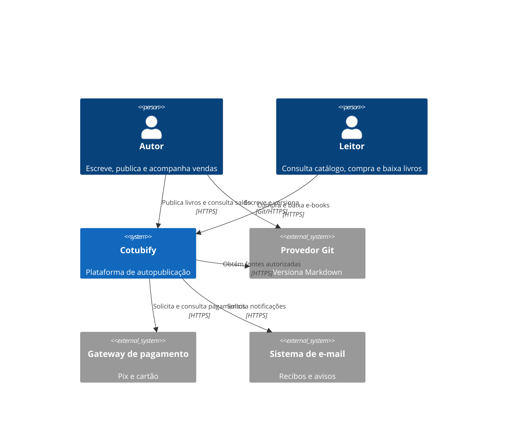
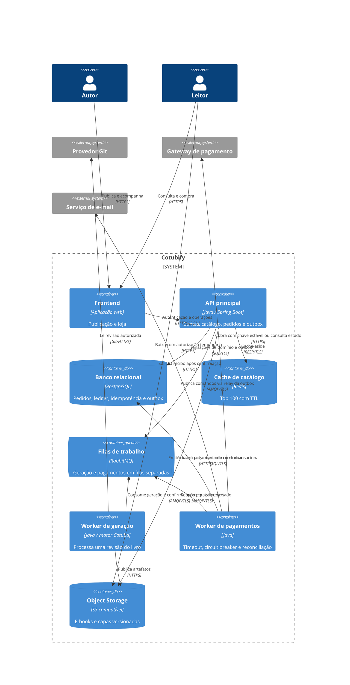

# Arquitetura Cotubify

Exercícios de System Design das tarefas 07, 12 e 14. O Cotubify é uma plataforma conceitual de autopublicação: autores conectam repositórios Markdown; leitores compram e baixam e-books. **Os diagramas e ADRs são modelagem; somente o motor CLI Cotuba está implementado.**

## Diagrama de Contexto



## Diagrama de Container — evolução proposta

Na tarefa 07, a API principal chamava o gerador por HTTP síncrono. A tarefa 12 substitui essa relação por fila e adiciona cache. A tarefa 14 desacopla o processamento de pagamentos. As tecnologias abaixo são escolhas deste exercício, não serviços provisionados.



## Decisões

- [ADR 001 — Geração assíncrona](adr/001-geracao-assincrona.md).
- [ADR 002 — Cache de catálogo](adr/002-cache-catalogo.md).
- [ADR 003 — Resiliência e idempotência de pagamentos](adr/003-resiliencia-pagamentos.md).

## Fluxo de Resiliência de Pagamento

```mermaid
sequenceDiagram
    actor Cliente
    participant API
    participant Banco
    participant Fila
    participant Worker
    participant Gateway
    Cliente->>API: Comprar (pedido, chave K)
    API->>Banco: Transação: pedido + operação K + outbox (UNIQUE)
    Banco-->>API: Operação pendente
    API-->>Cliente: 202 e URL de status
    Cliente->>API: Clique repetido (mesmo pedido e K)
    API->>Banco: Localizar K e conferir payload
    Banco-->>API: Operação já existente
    API-->>Cliente: Mesmo status, sem nova cobrança
    Note over Banco,Fila: Relay publica outbox; duplicação é possível
    Banco->>Fila: Comando de pagamento (K)
    Fila->>Worker: Entrega (pode repetir)
    Worker->>Banco: Claim/lease atômico da operação K
    alt Já concluída ou com execução válida em andamento
        Banco-->>Worker: Não executar outra cobrança
    else Operação elegível
        Worker->>Gateway: Cobrar (chave estável K, timeout limitado)
        Gateway--xWorker: Timeout ou 503 (resultado pode ser desconhecido)
        Worker->>Banco: Registrar estado desconhecido / próxima tentativa
        Note over Worker,Gateway: Circuito aberto impede novas chamadas; não confirma pagamento
        Worker->>Fila: Retentativa adiada com backoff, jitter e limite
        Note over Worker,Gateway: Após recuperação: consultar ou repetir com a MESMA K se o contrato permitir
        Worker->>Gateway: Consultar operação K
        Gateway-->>Worker: Resultado confirmado
        Worker->>Banco: Transação: resultado + ledger + notificação única
    end
    Cliente->>API: Consultar status
    API->>Banco: Ler resultado autorizado do pedido
    Banco-->>API: Pago, pendente ou falha definitiva
    API-->>Cliente: Estado real da operação
```

Não há promessa de exactly-once de ponta a ponta. A garantia depende de restrições duráveis, transações locais, idempotência aceita pelo provedor e reconciliação de resultados ambíguos. Redis sozinho não substitui o registro durável de pagamentos.
